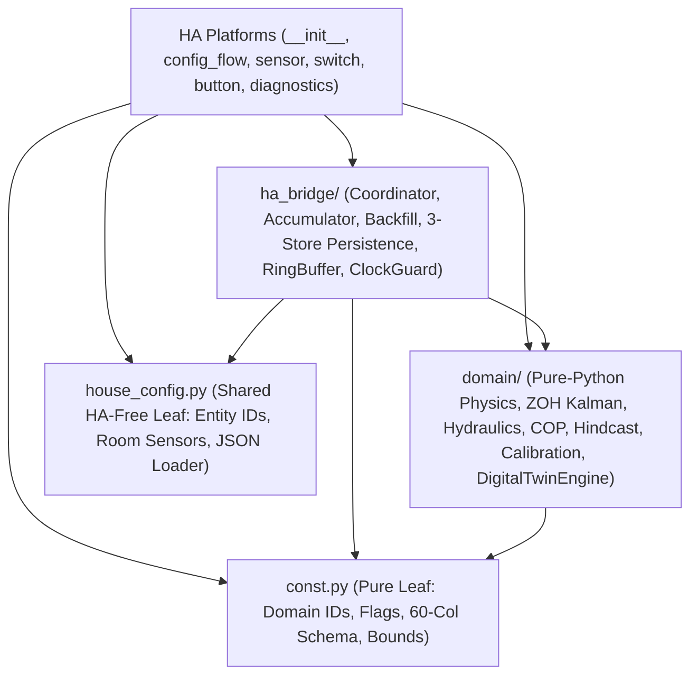

# BetonBatterij Custom Integration (`custom_components/betonbatterij/`)

Home Assistant custom integration implementing the **BetonBatterij Layer-1
Digital Twin** (`v0.1.1`) for hydronic underfloor heating and heat-pump thermal
modeling (`2R2C` + exact `3x3` ZOH Kalman filtering, secondary manifold
hydraulics, Carnot COP curves, 14-day hindcast evaluation, and autonomous MAP
parameter identification).

The integration runs with `"requirements": []` in `manifest.json` (pure Python
standard library only) and guards `homeassistant.*` imports so the domain and
bridge unit test suites execute offline in seconds.

## 1. Three-Layer Architecture & Strict Dependency Rules

BetonBatterij is organized into three strict horizontal layers plus two shared
pure-Python leaf modules (`house_config.py` and `const.py`):



### Dependency & Purity Rules (AST-Enforced)

- **`domain/` purity:** Zero `homeassistant.*`, `numpy`, `scipy`, or
  `house_config` imports anywhere in `domain/` (including inside function bodies
  and `TYPE_CHECKING` blocks), and a strict acyclic intra-package import DAG.
  See [`domain/README.md`](domain/README.md) for the complete mathematical core,
  module DAG, and physics invariants.
- **`house_config.py` isolation:** Zero `homeassistant.*` or `domain/` imports;
  owns only HA entity ID defaults and local JSON override loading, while all
  physical building priors live exclusively in `domain/priors.py`.
- **`ha_bridge/` boundary:** Owns all Home Assistant async I/O, event-bus
  aggregation, Recorder/LTS backfill, 3-store persistence, lock hierarchy, and
  periodic scheduling, while keeping its pure-Python primitives free of
  top-level `homeassistant.*` imports. Delegates all thermal, hydraulic, COP,
  and optimization math to `domain/`. See
  [`ha_bridge/README.md`](ha_bridge/README.md) for lock ordering, RingBuffer
  semantics, and backfill parity.
- **No cross-module private coupling:**
  `tests/test_structural_boundaries_and_bugs.py` enforces AST guards preventing
  `ha_bridge/coordinator.py`, `sensor.py`, `house_config.py`, and
  `domain/evaluation.py` from violating layer boundaries or reaching into
  private helpers or internal attributes of sibling layers.

## 2. Root Module Responsibilities

| Module            | Owns                                                                                                                                                                                                                                                                                                                                           | Does NOT Own                                                                                                                                                          |
| :---------------- | :--------------------------------------------------------------------------------------------------------------------------------------------------------------------------------------------------------------------------------------------------------------------------------------------------------------------------------------------- | :-------------------------------------------------------------------------------------------------------------------------------------------------------------------- |
| `__init__.py`     | `async_setup_entry` / `async_unload_entry`, options-update listener forwarding rotameter flow updates, shared `build_device_info()`, guarded `PLATFORMS` list, and public `async_get_engine(hass)` entrypoint for Layer 2.                                                                                                                     | Coordinator scheduling, entity definitions, persistence I/O, or thermal physics.                                                                                      |
| `const.py`        | Pure-Python leaf constants: `DOMAIN`, `VERSION`, 300 s grid timings, `MAX_RESTART_BRIDGE_GAP_S`, `FLOW_RATE_*` bounds, storage keys, `ALL_HYDRAULIC_GROUPS` / `FLOW_OPTION_KEYS` / `DEFAULT_FLOW_RATES_L_MIN`, 17 status bitmask `FLAG_*` constants, AC mode codes, and the canonical 60-column RingBuffer schema (`2` uint32 + `58` float32). | `homeassistant.*` imports, physical building priors (`domain/priors.py`), or entity IDs (`house_config.py`).                                                          |
| `house_config.py` | Generic placeholder `HouseEntityConfig` and `ROOM_SENSORS` mappings, `RoomSensorConfig` (including swap history fields), `LOCAL_CONFIG_FILENAME`, and `load_house_config()` for optional local JSON overrides.                                                                                                                                 | Home Assistant runtime state, `homeassistant.*` imports, `domain/` imports or physical priors (`domain/priors.py`), or real site-specific entity IDs in tracked code. |
| `config_flow.py`  | Single-instance 1-click `BetonBatterijConfigFlow` (seeding default rotameter flows) and `BetonBatterijOptionsFlow` with `build_rotameter_options_schema()` validating all 10 hydraulic groups against `[FLOW_RATE_MIN_L_MIN, FLOW_RATE_MAX_L_MIN]`.                                                                                            | Coordinator setup, epsilon-NTU `K_hx` rescaling (`domain/hydraulics.py`), or entity ID configuration.                                                                 |
| `sensor.py`       | All 13 sensor entities: `SmartThrottledSensor` deadband/heartbeat Recorder throttling, `ZoneMetricThrottledSensor` + `ZONE_METRIC_SPECS` (10 zone telemetry sensors), `BetonBatterijZoneFitSensor` (2 diagnostic fit sensors), and `BetonBatterijCopFitSensor` (1 live CV-COP diagnostic sensor).                                              | Direct Carnot COP math (`domain/cop_model.py`), 14-day hindcast computation (`domain/evaluation.py`), or private engine mutation.                                     |
| `switch.py`       | `BetonBatterijAutoKalibratieSwitch` (`switch.betonbatterij_auto_kalibratie`, `EntityCategory.CONFIG`, `RestoreEntity`) toggling weekly Sunday `03:15` auto-calibration via `coordinator.async_set_auto_calibrate()`.                                                                                                                           | Calibration scheduling logic or direct `.storage` persistence.                                                                                                        |
| `button.py`       | Declarative `BUTTON_DESCRIPTIONS` and stateless `BetonBatterijActionButton` wrappers exposing manual calibration, parameter rollback, Day-1 prior reset, and CSV/JSON diagnostics export.                                                                                                                                                      | Lock management, executor dispatch, or domain calibration/export logic (`ha_bridge/coordinator.py`, `domain/`).                                                       |
| `diagnostics.py`  | `async_get_config_entry_diagnostics()` returning a `sanitize_json_value`-cleaned, `async_redact_data`-redacted snapshot of coordinator config, clock guard, RingBuffer health, zone snapshots, COP parameters/diagnostics, and 14-day evaluation reports.                                                                                      | Raw entity-ID maps (`HOUSE_ENTITIES` / `ROOM_SENSORS`), raw 90-day RingBuffer rows, or private location coordinates.                                                  |

## 3. Home Assistant Entity Surface (18 Entities)

All 18 entities attach to a single Home Assistant device via
`build_device_info(entry_id)` across three platforms (`sensor`, `switch`,
`button`), each declaring `PARALLEL_UPDATES = 0`.

### 3.1 Zone Telemetry Sensors — 10 `SmartThrottledSensor` Entities

Defined declaratively via `ZONE_METRIC_SPECS` in `sensor.py` (5 for `wk` and 5
for `kt`), reading immutable `ZoneSnapshot` records from coordinator updates:

- **Floor temperature (`°C`):** `woonkamer_geschatte_vloertemperatuur`,
  `kantoor_geschatte_vloertemperatuur` (deadband `0.05 °C`, heartbeat `3600 s`;
  exposes `t_surface_c` plus unrecorded `t_floor_std_c`,
  `stored_slab_energy_wh`, and `sensor_stale`).
- **PVC floor surface temperature (`°C`):**
  `woonkamer_geschatte_pvc_oppervlaktetemperatuur`,
  `kantoor_geschatte_pvc_oppervlaktetemperatuur` (deadband `0.05 °C`, heartbeat
  `3600 s`).
- **Unplanned heat load `d_est` (`W`):** `woonkamer_ongeplande_warmtelast`,
  `kantoor_ongeplande_warmtelast` (deadband `25 W`, heartbeat `3600 s`, `15 W`
  zero-clamp threshold, immediate zero-crossing writes; exposes
  `open_window_active`).
- **Floor heat output `Q_fh` (`W`):** `woonkamer_vloer_afgiftevermogen`
  (deadband `50 W`), `kantoor_vloer_afgiftevermogen` (deadband `35 W`); both use
  `900 s` active heartbeat, `21600 s` (`6 h`) idle-zero heartbeat, and immediate
  zero-crossing writes.
- **6-hour open-loop hindcast (`°C`):** `woonkamer_hindcast_6u`,
  `kantoor_hindcast_6u` (deadband `0.05 °C`, heartbeat `1800 s`; exposes
  `warmup_remaining_min`).

`SmartThrottledSensor.evaluate_update()` suppresses redundant Recorder writes
unless the sensor is publishing for the first time, toggling availability,
crossing zero (when enabled), exceeding its deadband, or reaching its monotonic
heartbeat interval.

### 3.2 Zone Fit Diagnostic Sensors — 2 Entities

- `sensor.betonbatterij_fit_woonkamer` (`wk`) and
  `sensor.betonbatterij_fit_kantoor` (`kt`), both `EntityCategory.DIAGNOSTIC`,
  reporting the 14-day 6-hour hindcast RMSE (`°C`, 2 decimals).
- Gated on `coordinator.fit_sensor_generation` so they refresh only on startup,
  the 6-hour maintenance/evaluation cycle (`4x/day`), and calibration, rollback,
  or reset actions.
- Expose heavy structured attributes (all listed in `_unrecorded_attributes` to
  protect the Recorder database): `parameters_active`, `parameters_day1_prior`,
  `fisher_1sigma_std`, `correlation_matrix`, `collinearity_warnings`,
  `bound_warnings`, `regime_rmses`, `overall_6h`, `last_calibration`, and
  `ringbuffer_rows`.

### 3.3 Live CV-COP Fit Diagnostic Sensor — 1 Entity

- `sensor.betonbatterij_fit_warmtepomp_cop` (`EntityCategory.DIAGNOSTIC`, unit
  `"COP"`, 2 decimals).
- Recalculates live expected space-heating COP on every 5-minute tick by
  delegating to `engine.predict_live_expected_cop(row)` /
  `domain.cop_model.predict_live_expected_cop_from_row()` (which guards against
  DHW boiler water temperatures and post-DHW residual heat).
- Writes to the state machine when `fit_sensor_generation` changes, when live
  COP shifts by `>= 0.05`, or on a `3600 s` heartbeat; refreshes cached fitted
  parameters (`eta_carnot_cv`, `beta_defrost`, `eta_carnot_dhw`,
  `delta_p_wp_bias_w`), `live_expected_cop`, and `cop_diagnostics` whenever
  `fit_sensor_generation` advances (all attributes unrecorded).

### 3.4 Configuration Switch & Action Buttons — 5 Entities

- **Switch (1):** `switch.betonbatterij_auto_kalibratie`
  (`EntityCategory.CONFIG`, `RestoreEntity`) gates weekly Sunday `03:15`
  automatic MAP calibration (defaults to `on` on first install and syncs back to
  `.storage` via `coordinator.async_set_auto_calibrate`).
- **Buttons (4):**
  - `button.betonbatterij_herbereken_parameters` (`CONFIG`) — triggers manual
    executor-backed MAP calibration.
  - `button.betonbatterij_rollback_parameters` (`CONFIG`) — pops the previous
    parameter snapshot from the 8-deep rollback stack and replays 48 h.
  - `button.betonbatterij_reset_parameters` (`CONFIG`) — resets zone/COP/group
    parameters to Day-1 physical priors and replays 48 h.
  - `button.betonbatterij_exporteer_csv` (`DIAGNOSTIC`) — atomically exports
    `telemetry_5m.csv` and `fit_report.json` to `EXPORT_DIR_DEFAULT`.

## 4. Local Entity Override Contract (`betonbatterij_local.json`)

Tracked integration code contains **zero** real site entity IDs or personal room
names:

- `house_config.py` ships neutral placeholder defaults (`HOUSE_ENTITIES` and
  9-room `ROOM_SENSORS` using neutral 1st-floor keys `werkkamer_1e`,
  `kamer_1e_midden`, and `kamer_1e_zuid`).
- During startup, `BetonBatterijCoordinator` resolves
  `hass.config.path("betonbatterij_local.json")` (outside `custom_components/`
  so HACS updates never overwrite local mappings) and passes it to
  `load_house_config()`.
- Supported top-level JSON sections:
  - `"entities"`: overrides any field on `HouseEntityConfig`, including optional
    nullable sensors (`desk_kantoor_power_w`, `bg_manifold_supply_temp`,
    `bg_manifold_return_temp`, `floor_surface_sensor_wk`) and scalar
    `bg_manifold_return_offset_c`. Keys prefixed with `_` are ignored as
    comments; unknown keys log a warning without failing startup.
  - `"room_sensors"`: accepts either a temperature `entity_id` string or an
    object with `temp_entity_id`, optional `humidity_entity_id`, and optional
    historical sensor-swap metadata (`pre_swap_temp_entity_id`,
    `swap_timestamp_utc`) for seamless 90-day backfill continuity.
- **Diagnostics privacy guarantee:** `diagnostics.py` records only
  `"local_config_loaded": bool(...)` alongside redacted
  (`TO_REDACT = {"latitude", "longitude", "unique_id"}`) and
  `sanitize_json_value`-sanitized model telemetry. It intentionally omits
  `HOUSE_ENTITIES` and `ROOM_SENSORS` so local entity IDs and hardware
  identifiers are never exported.

## 5. Layer-2 Integration Entrypoint

Layer-2 controllers, MPC/MILP schedulers, and optimization integrations must
access Layer 1 strictly through the public entrypoint in `__init__.py` and the
read-only `ThermalTwinProtocol` exported by `domain/__init__.py`:

```python
from custom_components.betonbatterij import async_get_engine
from custom_components.betonbatterij.domain import ThermalTwinProtocol

engine: ThermalTwinProtocol | None = async_get_engine(hass)
if engine is not None:
    snap_wk = engine.get_zone_snapshot("wk")
    solver_model = engine.export_solver_model("wk", dt_s=1800.0)
```

- **What Layer 2 consumes:** O(1) immutable `ZoneSnapshot` readouts
  (`get_zone_snapshot`), deterministic side-effect-free rollouts
  (`simulate_step`, `simulate_horizon`), passive coasting and preheat lead-time
  estimates (`estimate_coast_duration`, `estimate_preheat_lead_time`),
  instantaneous floor sink capacity (`estimate_total_sink_capacity_w`),
  calibrated COP curves (`predict_cop_cv`, `predict_cop_dhw`, `cop_params`), and
  linearized 2x2 discrete solver matrices (`export_solver_model`).
- **Decoupling boundary:** Layer 2 never imports `BetonBatterijCoordinator`,
  never acquires coordinator locks, never reads or writes `.storage` or
  `ColumnarRingBuffer`, and never mutates internal Kalman, hydraulic, or
  calibration state.
