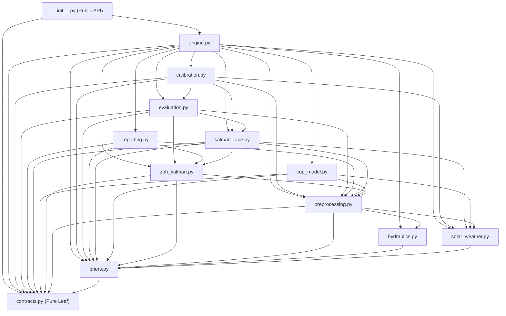

# BetonBatterij Domain Layer (`custom_components/betonbatterij/domain/`)

Pure-Python thermal physics, Kalman state estimation, waterside hydraulics,
heat-pump COP modeling, open-loop hindcast evaluation, and MAP parameter
identification for the BetonBatterij Layer-1 Digital Twin.

## 1. Purpose & Purity Contract

The `domain/` package implements the complete mathematical core of BetonBatterij
using **only the Python standard library** (`"requirements": []` in
`manifest.json`):

- **Zero external dependencies:** No `homeassistant.*`, `numpy`, or `scipy`
  imports anywhere in `domain/` (including inside function bodies and
  `TYPE_CHECKING` blocks).
- **Zero site/HA coupling:** No `house_config` imports, no Home Assistant entity
  IDs, no recorder queries, and no `asyncio` event-loop assumptions. Physical
  priors and box bounds live in `domain/priors.py`, while runtime coordinates
  (`latitude_deg`, `longitude_deg`) and rotameter flow rates are injected into
  `DigitalTwinEngine`.
- **Fast offline execution:** Every module and the full offline `pytest` suite
  run in seconds on a developer workstation without Home Assistant installed,
  and batch calibration executes on Raspberry Pi 4 without native C extensions.
- **Strict DAG:** Top-level intra-`domain` imports form an acyclic directed
  graph enforced by AST tests in `tests/test_structural_boundaries_and_bugs.py`.

## 2. Module Responsibility Table

| Module             | Owns                                                                                                                                                                                                                                                                                                                                                                                                                                                                                                                                                                                                                                          | Does NOT Own                                                                                                                                           |
| :----------------- | :-------------------------------------------------------------------------------------------------------------------------------------------------------------------------------------------------------------------------------------------------------------------------------------------------------------------------------------------------------------------------------------------------------------------------------------------------------------------------------------------------------------------------------------------------------------------------------------------------------------------------------------------- | :----------------------------------------------------------------------------------------------------------------------------------------------------- |
| `__init__.py`      | Curated public Layer-1 / Layer-2 export surface (`DigitalTwinEngine`, `ThermalTwinProtocol`, immutable domain dataclasses).                                                                                                                                                                                                                                                                                                                                                                                                                                                                                                                   | Internal calibration helpers, persistence adapters, or Home Assistant entities.                                                                        |
| `contracts.py`     | Pure leaf frozen dataclasses (`ZoneId`, `ParameterBounds`, `ThermalState`, `ZoneParameters`, `CopParameters`, `ZoneSnapshot`, `ExogenousStepInput`, `ActuatorStepInput`, `SimulationStepResult`, `PreheatEstimate`, `CoastEstimate`, `LinearizedDiscreteModel`, `RegimeHindcastMetrics`, `ZoneEvaluationReport`, `ParameterPosteriorMemory`, `CalibrationZoneOutcome`), strict `to_dict`/`from_dict` finite-float serialization, and runtime-checkable `ThermalTwinProtocol`.                                                                                                                                                                 | Any internal package imports (not even `const.py`), numerical physics, or stateful orchestration.                                                      |
| `priors.py`        | Single source of truth for building geometry, fallback site coordinates (`51.4, 5.5`), water/buffer physical constants (`BUF_BOT_SENSOR_OFFSET_C`, `C_BUF_J_K`), Day-1 `ZoneParameters` / `CopParameters`, `PARAM_BOUNDS_WK` / `PARAM_BOUNDS_KT` / `COP_PARAM_BOUNDS`, `DAY1_K_HX_BY_GROUP_W_K`, and `UNMODELED_GROUP_THERMAL_PROPS`.                                                                                                                                                                                                                                                                                                         | Home Assistant entity IDs, local JSON file loading (`house_config.py`), or runtime state.                                                              |
| `solar_weather.py` | Pure-Python NOAA solar position (`solar_position`), multi-pane Fresnel IAM (`fresnel_iam`), PV-to-facade/roof irradiance projection with screen attenuation & negative-EPEX curtailment fallback (`project_solar_irradiance`), sun-guarded outdoor temperature selection (`select_outdoor_temp`), soft 1st-floor interfloor boundaries (`compute_interfloor_boundaries`), and attic-office internal/split-AC load modeling (`compute_ac_heating_power_w`, `compute_internal_and_ac_loads_kt`).                                                                                                                                                | Timezone conversions (`preprocessing.py`), PVC floor surface temperature estimation (`zoh_kalman.py`), or RingBuffer ETL.                              |
| `hydraulics.py`    | Secondary manifold energy balance (`HydraulicModel`, `HydraulicStepResult`), epsilon-NTU flow scaling (`scale_k_hx_eps_ntu`), 200 L buffer bypass mixing (`HydraulicModel.compute_effective_supply_temp`), 30-minute telescoped calorimetric watcher (`gamma_cal` in `[0.75, 1.25]`), 1-node slab proxies for the 8 unmodeled groups, 25% downward 1st-floor ceiling leak into `wk`, optional ground-floor clamp-on supply/return override, and `HydraulicModel.estimate_total_sink_capacity_w`.                                                                                                                                              | Room air/slab Kalman state estimation (`zoh_kalman.py`) or raw columnar RingBuffer parsing (`preprocessing.py`).                                       |
| `preprocessing.py` | Shared telemetry ETL: local wall-clock conversion with EU DST fallback (`local_hour_minute`), canonical zone-to-group mapping (`zone_to_hydraulic_group`), finite-number parsing and unified raw 5-minute row parsing (`RawStepParsed`, `parse_raw_step`), `FLAG_LTS_BACKFILL` and legacy hourly LTS detection (`detect_lts_and_missing_prim_rows`), raw-aware chronological train/holdout split (`compute_train_holdout_split`), 52-week Bayesian precision aging (`age_precision_memory`), and columnar history preprocessing (`PreprocessedHistory`, `preprocess_history_columns`, `recompute_history_for_khx`, `build_zone_exog_list`).   | Kalman recursion (`zoh_kalman.py`, `kalman_tape.py`), hindcast scoring (`evaluation.py`), or CSV/JSON disk export (`reporting.py`).                    |
| `zoh_kalman.py`    | Exact 3x3 ZOH discretization with `S = diag(1, 1, 1e-3)` balancing (`discretize_ab_cached`, `discretize_zoh_3x3`), unit-basis Lyapunov-Taylor doubling for `Q_d` (`discretize_qd_basis_cached`), open-loop ZOH step propagation (`propagate_open_loop_step`), PVC surface temperature divider (`surface_temp_divider_gamma`, `estimate_surface_temp`, `estimate_zone_surface_temp`), 2x2 MILP/MPC solver export (`export_2r2c_solver_model`), ZHA resolution detection (`ResolutionDetector`), Tobit deadband pseudo-updates (`tobit_equivalent_innovation`), Joseph-form scalar updates (`joseph_scalar_update`), and `ZoneKalmanEstimator`. | Columnar RingBuffer ETL (`preprocessing.py`), unrolled batch tapes (`kalman_tape.py`), or multi-regime hindcast scoring (`evaluation.py`).             |
| `cop_model.py`     | Heat-pump Carnot COP curves for space heating (`predict_cop_cv`) and two-stage DHW across the `51.0 °C` compressor ceiling (`predict_cop_dhw`), evaporator frost penalty (`frost_penalty_factor`), authoritative live CV-COP readout with DHW/residual-heat guard (`predict_live_expected_cop_from_row`), 200 W quantization bias correction (`corrected_wp_electrical_power_w`), nocturnal P1 flank bias identification (`calibrate_p1_power_bias`), and Huber MAP COP fitting (`fit_cop_parameters`).                                                                                                                                       | Zone 2R2C thermal dynamics (`zoh_kalman.py`), manifold hydraulics (`hydraulics.py`), or Home Assistant sensor publishing.                              |
| `kalman_tape.py`   | Parameter-independent 1D exogenous & sensor tapes (`MeasMode`, `PrecomputedZoneTape`, `build_zone_tape`, `get_zone_tape`) and unrolled scalar fast paths (`run_kalman_on_tape`, `evaluate_windows_on_tape`, `reconstruct_states_on_tape`, `reconstruct_states_tuples`, `rollout_open_loop_window_fast`) mirroring `zoh_kalman.py` for multi-second LM calibration on 90-day histories.                                                                                                                                                                                                                                                        | Continuous-to-discrete matrix discretization (`zoh_kalman.py`), RingBuffer ETL (`preprocessing.py`), or hindcast report aggregation (`evaluation.py`). |
| `reporting.py`     | Recursive non-finite float sanitization (`sanitize_json_payload`) for strict JSON persistence and atomic `.tmp -> flush -> fsync -> os.replace` export of 31-column `telemetry_5m.csv` and `fit_report.json` (`CSV_EXPORT_COLUMNS`, `export_csv_and_report`).                                                                                                                                                                                                                                                                                                                                                                                 | Hindcast metric calculation (`evaluation.py`), Kalman filtering (`zoh_kalman.py`), or Home Assistant `Store` adapters.                                 |
| `evaluation.py`    | 14-day multi-regime open-loop hindcast evaluation (`evaluate_14d_hindcast`) with dual reconstruction against Day-1 priors, reference object-level Kalman reconstruction (`reconstruct_kalman_states`), live 72-step (6-hour) open-loop FIFO tracker (`LiveHindcastTracker`), and `ZoneEvaluationReport` dict serialization (`zone_eval_report_to_dict`, `zone_eval_report_from_dict`).                                                                                                                                                                                                                                                        | RingBuffer ETL (`preprocessing.py`), unrolled calibration tapes (`kalman_tape.py`), or disk file I/O (`reporting.py`).                                 |
| `calibration.py`   | Pure-Python Box-Projected Huber Levenberg-Marquardt MAP solver (`solve_b2_box_huber_lm`, `SolverResult`) with Fisher covariance and collinearity diagnostics, 52-week precision-weighted memory (`compute_aged_prior`, `update_posterior_memory`), stratified 365-day `SeasonalEpisodeBank`, steady-state `K_hx` calibration (`calibrate_k_hx_robust`), autonomous seasonal/cooling gate (`check_seasonal_calibration_gate`), and joint multi-horizon trajectory calibration with out-of-sample holdout acceptance gating (`calibrate_zone_a2`).                                                                                              | RingBuffer ETL (`preprocessing.py`), COP curve fitting (`cop_model.py`), lock management, or Home Assistant persistence (`engine.py`, `ha_bridge/`).   |
| `engine.py`        | Stateful Layer-1 facade (`DigitalTwinEngine`): real-time 5-minute pipeline (`process_5m_window`), 48-hour post-calibration replay (`replay_48h_from_columns`), lock-free 3-phase calibration (`capture_calibration_context`, `@staticmethod compute_calibration_plan`, `apply_calibration_plan`), 8-deep rollback stack & Day-1 reset, `update_flow_rates`, read-only `ThermalTwinProtocol` methods for Layer 2, and full JSON-safe persistence (`to_state_dict`, `load_state_dict`).                                                                                                                                                         | Home Assistant entities, recorder/backfill queries, async locks, or disk storage (`ha_bridge/`).                                                       |

## 3. Acyclic Dependency Graph (DAG)

Top-level runtime imports flow strictly downward from the public API and
stateful facade to leaf contracts (`consumer --> dependency`; all modules above
`priors.py` may also import top-level `const.py`):

> **Note on static typing:** `preprocessing.py` holds a `TYPE_CHECKING`-only
> import of `kalman_tape` to annotate the cached `tape_wk` / `tape_kt` slots on
> `PreprocessedHistory`, which introduces no runtime import cycle.

## 4. Non-Obvious Cross-File Correlations & Invariants

1. **State & Input Vector Ordering, Coordinate Balancing, and Off-Diagonal ZOH
   Couplings:**

   - Across `zoh_kalman.py`, `kalman_tape.py`, and `engine.py`, the 3-state
     vector is strictly `x = [T_air, T_floor, d_est]^T` (`[°C, °C, W]`) and the
     7-input vector is strictly
     `u = [T_out, T_up, T_down, I_sol, Q_fh, Q_int, Q_ac]`.
   - Because `d_est` is ~`10^3` larger in magnitude than temperature states,
     `discretize_ab_cached` and `_lyapunov_van_loan_3x3` balance coordinates via
     `S = diag(1, 1, 1e-3)` (`A_tilde_c = S A_c S^-1`) before 12th-order Taylor
     - scaling-and-squaring discretization and unscale afterward.
   - All 7 columns of `B_d = Psi(dt) @ B_c` (including every off-diagonal
     floor-to-air and air-to-floor coupling) MUST be preserved in both
     `zoh_kalman.propagate_open_loop_step` and `kalman_tape.py` rollouts so
     multi-step ZOH propagation satisfies semigroup consistency and adiabatic
     energy conservation.

1. **Asymmetric Vent-Decay Row Split (`zoh_kalman.py` & `kalman_tape.py`):**

   - When `d_est < -1.0 W` and either `open_window_active` is True or
     `d_est < -150.0 W`, `ZoneKalmanEstimator.step` and
     `kalman_tape.run_kalman_on_tape` accelerate disturbance decay from nominal
     `tau_d_h` (`1.8 h`) to `TAU_D_VENT_S = 1200 s` (`20 min`) for the `T_air`
     row (`row 0`) and `d_est` row (`row 2`) plus covariance propagation, while
     intentionally keeping the nominal `tau_d_h` matrices (`a_d_nom[1]`,
     `b_d_nom[1]`) for the `T_floor` row (`row 1`). Both paths must remain
     identical.

1. **Unit, Sign, and Sensor Offset Conventions:**

   - Thermal capacities are stored in `Wh/K` (converted to `J/K` via `* 3600.0`
     inside discretization), floor-to-air resistance in `K/kW`
     (`h_fh = 1000 / r_fh_k_kw` in `W/K`), time constants in `h`, and powers in
     signed Watts (`Q_ac < 0` during AC defrost, cooling, or dry mode).
   - Exterior screens use `[0..100]` where `100 = fully open` and `0 = closed`
     (transmitting 10% direct beam and 45% diffuse daylight when closed,
     weighted `0.35` small / `0.65` large).
   - Wind excess is bucketed as `max(0.0, v_wind_ms - 3.0)` (zero when
     `c_wind == 0.0` or `v_wind_ms <= 3.0 m/s`), maximizing ZOH cache reuse.
   - `BUF_BOT_SENSOR_OFFSET_C = -0.33 °C` (the raw bottom buffer sensor reads
     `+0.33 °C` high) is applied **once** inside `HydraulicModel` from raw
     `t_buf_bot_start_c` / `t_buf_bot_end_c`. `preprocessing.py` derives
     `t_buf_bot_cal_c` solely for reporting while still feeding raw start/end
     buffer bottom temperatures into `HydraulicModel.step` — never apply the
     offset twice.

1. **Canonical Zone ID vs. Hydraulic Group Normalization:**

   - Modeled thermal zones use `ZoneId` keys `"wk"` and `"kt"`, whereas the 10
     waterside hydraulic manifold groups use `"wk"`, `"kantoor"`, `"gang"`,
     `"slaapkamer"`, `"badkamer"`, `"werkkamer_1e"`, `"kamer_1e_midden"`,
     `"kamer_1e_zuid"`, `"badkamer_boven"`, and `"logeerkamer"`.
   - Always normalize `"kt" -> "kantoor"` through
     `preprocessing.zone_to_hydraulic_group` when crossing between zone
     parameters and hydraulic group dictionaries (`k_hx_by_group_w_k`,
     `flow_rates_l_min`).

1. **Training vs. Evaluation Open-Loop Semantics & Fair Holdout Gating:**

   - **Training (`kalman_tape.evaluate_windows_on_tape`):** Starts each window
     rollout from the Kalman posterior `(T_air(k0), T_floor(k0))` with
     `d_est = 0` so physical parameters cannot hide persistent bias inside the
     disturbance state.
   - **Evaluation (`evaluation.evaluate_14d_hindcast` &
     `LiveHindcastTracker`):** Starts open-loop rollouts from the full decaying
     posterior `(T_air(k0), T_floor(k0), d_est(k0))`, reflecting real Layer-2
     forecasting.
   - **Dual-Reconstruction Skill Score & Shared `_ref_d_act` Gate:**
     `evaluate_14d_hindcast` runs independent parameter-consistent Kalman
     reconstructions for `params_eval` and `params_prior` so neither incurs an
     initial-state enthalpy jump. During holdout acceptance gating in
     `calibration.calibrate_zone_a2`, both `holdout_before` and `holdout_after`
     receive the exact same `_ref_d_act` disturbance mask (from
     `params_map_raw`) so both parameter sets are scored on identical clean
     windows.

1. **Structural Immutability of `ZoneParameters`:**

   - `ZoneParameters` is declared `@dataclass(frozen=True, slots=True)`. This
     immutability is a hard functional requirement (not merely defensive style):
     `zoh_kalman.discretize_ab_cached` and `discretize_qd_basis_cached` key
     their `@lru_cache(maxsize=512)` tables directly on `ZoneParameters`
     instances. Always derive modified parameter sets via
     `dataclasses.replace(...)`.

1. **Offline Humidity Heartbeat, LTS Detection & Raw-Aware Split:**

   - In offline replay (`evaluation.reconstruct_kalman_states` and
     `kalman_tape.build_zone_tape`), fine-resolution (`0.01 °C`) sensors that
     remain unchanged for `>= 1800 s` receive a synthetic `k % 6 == 0`
     (30-minute) humidity heartbeat update (`R_MEAS_HEARTBEAT_FINE_K2`),
     matching online ZHA liveness without persisting humidity timestamps per
     column.
   - `preprocessing.detect_lts_and_missing_prim_rows` identifies both explicitly
     flagged `FLAG_LTS_BACKFILL` rows and legacy hourly-interpolated LTS
     segments (using a `float32`-tolerant second-difference check across
     independent channels), plus rows lacking valid primary thermal power
     (`p_prim_th_w` / `t_wp_out_c` / `t_wp_in_c`).
   - `preprocessing.compute_train_holdout_split` ensures both the training slice
     and out-of-sample holdout slice contain genuine non-LTS Recorder rows
     whenever at least 4 days of non-LTS telemetry exist.

1. **3-Phase Lock-Free Calibration & Single-Damping `k_hx_w_k` Rule:**

   - Batch calibration is strictly split into three phases so the Home Assistant
     coordinator never holds its processing lock across multi-minute solver
     runs:
     1. `engine.capture_calibration_context()` (`< 1 ms`, under lock): clones
        parameters, memories, `episode_bank`, and records `param_epoch`.
     1. `DigitalTwinEngine.compute_calibration_plan(columns, context, mode)`
        (pure `@staticmethod`, lock-free in executor): structurally incapable of
        reading or mutating live engine state.
     1. `engine.apply_calibration_plan(plan, recent_columns)` (`< 20 ms`, under
        lock): aborts safely (`aborted_stale_epoch=True`) if `param_epoch`
        advanced concurrently (e.g., via rollback, reset, or flow update),
        otherwise commits parameters, increments `param_epoch`, and replays the
        last 48 hours.
   - In `mode="auto_weekly"`, `compute_calibration_plan` damps `k_hx` once
     (`0.80 * old + 0.20 * raw`) across all hydraulic groups (`wk`, `kantoor`,
     `gang`, ...) and passes `khx_already_damped=True` to
     `calibration.calibrate_zone_a2` so `_blend_zone_parameters` preserves the
     already-damped `k_hx_w_k` instead of double-damping it.

1. **`K_hx` Synchronization Invariant on `update_flow_rates`:**

   - Calling `engine.update_flow_rates(flow_rates_l_min)` updates rotameter
     flows, rescales every group's `K_hx` via the epsilon-NTU law in
     `hydraulics.HydraulicModel.update_flow_rates`, copies the scaled map back
     into `engine._k_hx_by_group_w_k`, replaces `k_hx_w_k` on both `_params_wk`
     and `_params_kt`, syncs `estimator_wk.params` and `estimator_kt.params`,
     increments `param_epoch` (invalidating any in-flight calibration plan), and
     refreshes cached `ZoneSnapshot`s.

## 5. Layer 2 Public Contract

Layer-2 planners, MPC/MILP optimizers, and Home Assistant climate controllers
must consume Layer 1 strictly through the read-only boundary exported by
`custom_components.betonbatterij.domain` (`domain/__init__.py`) and typed as
`ThermalTwinProtocol`:

- **Entry point in Home Assistant:** Obtain the active engine via
  `async_get_engine(hass)` (or `entry.runtime_data.engine`) and treat it as a
  `ThermalTwinProtocol`.
- **Curated exports (`domain/__init__.py`):** `DigitalTwinEngine`,
  `ThermalTwinProtocol`, `ZoneId`, `ThermalState`, `ZoneParameters`,
  `CopParameters`, `ZoneSnapshot`, `ExogenousStepInput`, `ActuatorStepInput`,
  `SimulationStepResult`, `PreheatEstimate`, `CoastEstimate`,
  `LinearizedDiscreteModel`, and `ZoneEvaluationReport`.
- **Guaranteed side-effect-free operations on `ThermalTwinProtocol`:**
  - `get_zone_snapshot(zone)` — O(1) immutable cached readout (`T_air`,
    `T_floor`, `d_est`, PVC surface estimate, stored slab energy, 6h hindcast,
    staleness/open-window flags, `warmup_remaining_min`).
  - `simulate_step(...)` & `simulate_horizon(...)` — deterministic forward ZOH
    scenario rollouts with zero mutation of online Kalman or hydraulic state.
  - `estimate_coast_duration(...)` & `estimate_preheat_lead_time(...)` — passive
    coasting, slab overshoot, and surface-capped preheat lead-time queries.
  - `estimate_total_sink_capacity_w(...)` — instantaneous secondary floor heat
    uptake across open loops for anti-short-cycling checks.
  - `predict_cop_cv(...)`, `predict_cop_dhw(...)`, and `cop_params` — calibrated
    heat-pump COP forecasts.
  - `export_solver_model(zone, dt_s=1800.0)` — linearized 2x2 ZOH matrices
    (`phi_2x2`, `gamma_fh`, `gamma_ac_el_ref`), total steady-state loss, and
    dominant passive coasting time constant for external MILP/MPC solvers.
- **Forbidden for Layer 2:** Directly mutating `estimator_*`, `hydraulics`,
  `episode_bank`, `snapshot_stack`, calibration routines, or persistence
  dictionaries.
